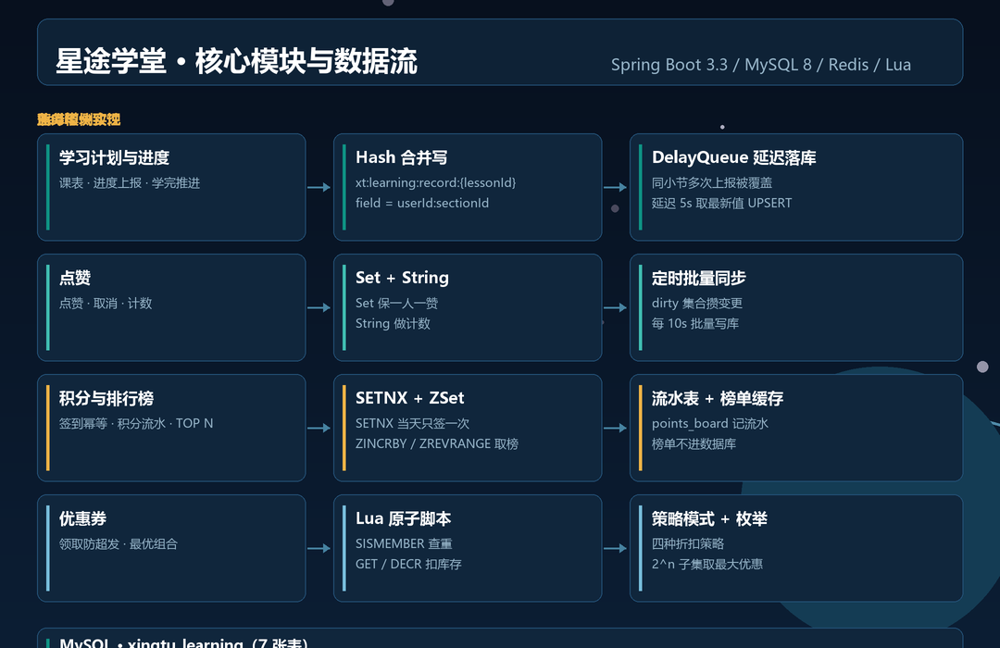

# 星途学堂 · 在线教育平台核心模块（可运行版）

> **星途学堂**——「星辰之路，学以致用」。以学习者成长为主线的在线教育平台，
> 前端 / 后端 / 数据库三层结构，自带 Web 学习中心与 AI 学习助手。

技术栈：Spring Boot 3.3 / JDK 17 / MySQL 8 / Redis / JdbcTemplate / Redis Lua / 原生 JS SPA

## 项目结构（前端 / 后端 / 数据库三层）

```
xingtu-learning/
│
├── 【前端】 src/main/resources/static/
│   └── index.html              # 学习中心单页应用（深空主题）
│                                #   课表/课程阅读/笔记/打卡/徽章/学习助手
│                                #   由 Spring Boot 静态托管，无需单独起服务
│
├── 【后端】 src/main/java/com/xingtu/learning/
│   ├── common/                 # 统一响应 Result / 业务异常 / 全局处理
│   ├── course/                 # 课程目录 / 章节大纲 / 章节正文 / 随堂小测
│   ├── learning/               # 课表、进度上报、延迟任务（DelayQueue + Redis 合并）
│   ├── like/                   # 点赞、异步同步
│   ├── points/                 # 签到、积分、ZSet 排行榜
│   ├── coupon/                 # 优惠券（Lua 防超发）、最优组合
│   ├── note/                   # 学习笔记、学习广场
│   ├── streak/                 # 连续打卡、日历
│   ├── badge/                  # 成就徽章（事件驱动自动颁发）
│   └── agent/                  # 🤖 学习助手 Agent（诊断/推荐/答疑/规划）
│
├── 【数据库】 sql/
│   ├── schema.sql              # 13 张表结构（先执行）
│   ├── data.sql                # 基础数据：课表 / 券 / 徽章定义
│   ├── course_content.sql      # 课程内容：2 门课 20 章（正文+小测）
│   └── reference/              # 参考表结构存档
│
├── http/api.http               # 接口调试示例
├── scripts/demo.sh             # 一键接口演示
└── docker-compose.yml          # MySQL + Redis 中间件
```

## 怎么打开运行（三步）

### 第 1 步：启动数据库层

方式 A（本机已装）：
```bash
# MySQL（默认 root/1234，3306 端口）与 Redis（6379）需已在运行
```

方式 B（Docker）：
```bash
docker compose up -d          # 起 MySQL 3306 + Redis 6379
```

### 第 2 步：初始化数据 + 启动后端

```bash
# 初始化数据库（首次 / 需要重置数据时）
mysql -uroot -p < sql/schema.sql
mysql -uroot -p < sql/data.sql
mysql -uroot -p < sql/course_content.sql

# 打包并启动后端（默认端口 8081）
mvn clean package -DskipTests
java -jar target/xingtu-learning-1.0.0.jar --server.port=8081
```

### 第 3 步：浏览器打开前端

```
http://localhost:8081/
```

即进入「星途学堂 · 学习中心」：点课程卡片 → 看大纲 → 点章节 → 阅读正文 → 做随堂小测 → 点「完成本章学习」，进度 / 积分 / 徽章全部联动。

> 说明：本仓库把在线教育微服务体系的架构思路**独立实现**为精简可运行版本（单应用、四模块），
> 保留关键设计（延迟队列合并写、Redis 计数异步落库、ZSet 排行榜、策略模式 + Lua 防超发），
> 去掉企业内网依赖（注册中心集群、网关、多服务拆分的公共服务环境），保证 clone 下来即可跑通。

## 模块与数据流



## 已实现模块

| 模块 | 能力 | 关键技术 |
| --- | --- | --- |
| 学习计划与进度 | 课表、进度上报、学完推进、进度百分比 | Redis Hash 合并写 + `DelayQueue` 延迟落库 |
| 点赞 | 点赞 / 取消 / 计数 / 一人一赞 | Redis Set 去重 + String 计数 + dirty 集合异步同步 |
| 积分与排行榜 | 签到（每日幂等）、积分流水、TOP N 排行 | Redis SETNX 幂等 + ZSet 排行榜 |
| 优惠券 | 领取（防超发）、我的券、最优优惠组合 | Redis + Lua 原子扣减 + 折扣策略模式 + 组合枚举 |
| 学习笔记 | 笔记增删改查、私密/公开、学习广场 | MySQL 落库 + 公开笔记广场流 |
| 连续打卡 | 每日打卡、连续天数、最长记录、打卡日历 | 日期连续性判定 + 徽章联动 |
| 成就徽章 | 6 种徽章自动颁发、成就墙、最近获得 | 业务事件驱动 + 幂等颁发（INSERT IGNORE） |

> 浏览器访问 `http://localhost:8081/` 即可打开「星途学堂 · 学习中心」控制台，这是本仓库自带的 Web UI（Spring Boot 静态资源托管），支持课表、笔记、打卡、徽章全部功能。

## 快速开始

前置：JDK 17+、Maven 3.6+、MySQL 8、Redis（或用下面的 docker-compose）

```bash
# 1. 建库建表 + 演示数据
mysql -uroot -p < sql/schema.sql
mysql -uroot -p < sql/data.sql

# 2. 改数据库/Redis 连接（默认 root/1234、localhost:6379 无密码）
#    编辑 src/main/resources/application.yml

# 3. 打包运行（默认端口 8081）
mvn clean package -DskipTests
java -jar target/xingtu-learning-1.0.0.jar

# 4. 走一遍接口
bash scripts/demo.sh          # 或按 http/api.http 逐条执行
```

用 Docker 起中间件：

```bash
docker compose up -d          # MySQL 3306 + Redis 6379
```

## 接口一览

| 方法 | 路径 | 说明 |
| --- | --- | --- |
| GET | `/api/learning/lessons?userId=1` | 我的课表 |
| GET | `/api/learning/summary?userId=1` | 课表进度百分比 |
| POST | `/api/learning/records` | 上报学习进度（写 Redis 合并缓冲区） |
| GET | `/api/learning/pending?lessonId=1` | 查看尚未落库的合并结果 |
| GET | `/api/learning/records?userId=1&lessonId=1` | 已落库的学习记录 |
| POST | `/api/like` | 点赞 |
| DELETE | `/api/like` | 取消点赞 |
| GET | `/api/like/count?bizType=1&bizId=1001` | 点赞数 |
| POST | `/api/like/sync` | 手动同步（生产由定时任务执行） |
| POST | `/api/points/sign?userId=1` | 签到 |
| GET | `/api/points/rank?topN=10` | 排行榜 |
| POST | `/api/coupon/{couponId}/receive?userId=1` | 领取优惠券 |
| GET | `/api/coupon/mine?userId=1` | 我的可用券 |
| POST | `/api/note/create?userId=1&lessonId=1&sectionId=101&content=xxx&isPublic=1` | 新建笔记 |
| GET | `/api/note/mine?userId=1&lessonId=1` | 我的笔记 |
| GET | `/api/note/public?limit=20` | 学习广场（公开笔记） |
| POST | `/api/note/update?userId=1&noteId=1&content=xxx&isPublic=1` | 编辑笔记 |
| DELETE | `/api/note/delete?userId=1&noteId=1` | 删除笔记 |
| POST | `/api/streak/checkin?userId=1` | 每日打卡 |
| GET | `/api/streak/status?userId=1` | 连续天数与今日状态 |
| GET | `/api/streak/calendar?userId=1&days=30` | 打卡日历 |
| GET | `/api/badge/my?userId=1` | 我的成就墙（已获得/未解锁） |
| GET | `/api/badge/recent?userId=1&limit=10` | 最近获得的徽章 |
| POST | `/api/coupon/best` | 计算最优优惠组合 |

## 关键设计

### 1. 学习进度：合并写 + 延迟落库

播放进度每几秒上报一次，直接写库会产生大量无效 IO。

```
上报 → Redis Hash (learning:record:{lessonId}, field = userId:sectionId)
     → DelayQueue 延迟任务（默认 5s）
     → 到点取 Redis 最新值，一次 UPSERT 落库 → 学完则推进课表进度并加积分
```

同一小节多次上报会在 Hash 中被覆盖，天然完成合并；`pending` 接口可以看到合并过程。

### 2. 点赞：Redis 计数，异步同步

`xt:like:users:{type}:{id}` 用 Set 保证一人一赞，`xt:like:count:{type}:{id}` 做计数，
有变化的业务对象进 `xt:like:dirty`，由定时任务（默认 10s）批量 UPSERT 到 `like_count`、批量 `INSERT IGNORE` 到 `like_record`。

### 3. 排行榜：ZSet

积分流水落 `points_board` 表，累计积分与排名放 `xt:points:rank` ZSet，`ZINCRBY` 累加、`ZREVRANGE` 取 TOP N，避免每次查榜都做聚合。

### 4. 优惠券：Lua 防超发 + 策略模式算最优

```lua
if redis.call('SISMEMBER', KEYS[2], ARGV[1]) == 1 then return -1 end   -- 已领过
local stock = tonumber(redis.call('GET', KEYS[1]) or '0')
if stock <= 0 then return 0 end                                       -- 已抢光
redis.call('DECR', KEYS[1])
redis.call('SADD', KEYS[2], ARGV[1])
return 1
```

折扣算法用策略模式（`Discount` + `DiscountFactory`）按券类型分发，四种券：无门槛立减、满减、每满减、折扣率；
最优优惠对可用券做组合枚举（最多 10 张，2^n 种子集）取优惠最大的一组。

## 实测结果（本地 JDK 22 + MySQL 8 + Redis，逐接口跑通）

```
上报 30s（未学完）        → 缓冲区 1 条，pendingTasks=1
同小节再报 150s（学完）    → 缓冲区仍 1 条，值被覆盖为 "150,1,1"
延迟 5s 后落库            → learning_record: moment=150, finished=1
课表进度                  → 「星途 · Java 微服务架构实战」已学 2/12，进度 16%
点赞 user2 / user3 / user4 → count 递增；重复点赞被一人一赞拦截
取消点赞 user3            → count 回落
手动同步                  → syncedBizCount=N, dirtyLeft=0
签到                      → +2 分；重复签到被拦截「今天已经签到过了」
排行榜                    → 按累计积分倒序：user1(6分) → user2(2分)
领取星途券                 → 「星途启航·新人券」等 4 张库存 100→99；重复领取被 Lua 拦截
订单 350 元最优组合        → 「星途满减·满200减30」优惠 30 元，应付 320 元
```

## 目录结构

```
xingtu-learning
├── src/main/java/com/xingtu/learning
│   ├── common          # 统一响应、业务异常、全局异常处理
│   ├── learning        # 课表、学习记录、延迟任务（DelayQueue + Redis 合并）
│   ├── like            # 点赞、异步同步任务
│   ├── points          # 签到、积分流水、ZSet 排行榜
│   ├── coupon          # 领取（Lua）、折扣策略、最优组合
│   ├── note            # 学习笔记、学习广场
│   ├── streak          # 连续打卡、打卡日历
│   └── badge           # 成就徽章定义与自动颁发
├── src/main/resources/static   # 「星途学堂 · 学习中心」Web UI
├── sql
│   ├── schema.sql      # 表结构（11 张表）
│   ├── data.sql        # 演示数据（2 门星途课程、4 张星途券、6 枚徽章）
│   └── reference       # 参考表结构，仅存档
├── docs/模块设计笔记.md
├── http/api.http       # 可直接执行的接口示例
└── docker-compose.yml
```

## 说明

- 业务建模参考在线教育行业主流的微服务拆分方案，代码为本项目独立编写。
- 这是单体可运行版本，用于展示核心业务设计；企业版按业务域拆分为网关、学习、促销等十余个微服务。
